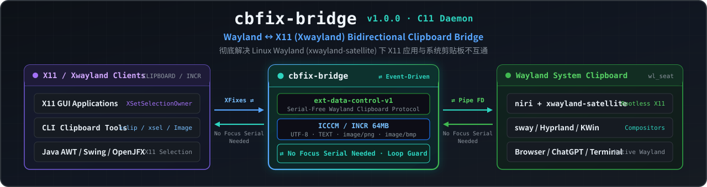

<div align="center">



# cbfix-bridge

**彻底修复 Linux Wayland 桌面上 X11 / XWayland 应用与系统剪贴板不互通的顽疾**

[](https://github.com/macOS-Terminal/linux-clipboard-fix/releases/latest)
[](https://github.com/macOS-Terminal/linux-clipboard-fix/releases/latest)
[](https://github.com/macOS-Terminal/linux-clipboard-fix/stargazers)
[](LICENSE)


**[简体中文](README.md) | [English](README_EN.md)**

</div>

> 在 `niri`（搭配 `xwayland-satellite`）、`sway`、`Hyprland` 等 Wayland 合成器下，运行在 XWayland 里的 **X11 应用**（如 Java AWT/Swing/OpenJFX 应用、调用 `xclip`/`xsel` 的 CLI 工具、Wine 程序及传统 X11 GUI 软件）经常陷入“复制了别处粘不出、浏览器复制了粘贴框空白”的剪贴板孤岛。`cbfix-bridge` 以单个零运行时框架依赖的 C11 守护进程，基于 `ext-data-control-v1` 与 ICCCM `INCR` 协议打通 **Wayland ⇄ X11 CLIPBOARD** 双向无损同步。
>
> **⭐ 如果这个工具拯救了你的剪贴板体验，请点亮右上角 [Star](https://github.com/macOS-Terminal/linux-clipboard-fix/stargazers) 支持本项目！这能让更多被 XWayland 剪贴板问题困扰的 Linux 用户与开发者搜到它。**

- 单文件 C11 程序，无运行时框架依赖
- 双向同步，支持文本与图片（`image/png` / `image/bmp`）
- 完整实现 ICCCM 大负载分片传输（`INCR`），实测到 5 MB 逐字节一致
- systemd 用户服务，`enable --now` 即用
- MIT 许可

---

## 症状长什么样

| 场景 | 表现 |
|---|---|
| 在 X11 / Java GUI 应用里复制文本 → 浏览器粘贴 | 粘贴出上一次的旧内容，或空白 |
| 在 Wayland 浏览器复制 → X11 应用里粘贴 | 粘贴框空着，无反应 |
| 在终端通过 `xclip` / `xsel` 或 X11 CLI 工具复制输出 → 编辑器粘贴 | 无内容 |
| 装了 `xclip` / `xsel` 也没用 | 它们只能在 X11 内部互通，跨不过 Wayland 边界 |

如果你把 `DISPLAY` 清空、只留 Wayland 环境，某些应用的剪贴板反而正常——这通常说明该应用其实跑在 Wayland 原生后端，问题不在你。

### 常见搜索症状 / 报错速查（SEO 索引）

如果你在 Google、Bing、GitHub Issues 或社区搜索以下问题来到这里，`cbfix-bridge` 正是为你准备的通用解决方案：

- **`xwayland-satellite CLIPBOARD set from X11` 但 `wl-paste` 内容不变**：`xwayland-satellite` 尝试用普通 `wl_data_device` 写剪贴板，因缺少焦点 serial 被合成器静默拒绝，且未实现 Wayland → X11 方向同步。
- **`niri / sway / Hyprland 下 XWayland 应用无法与 Wayland 浏览器互通剪贴板`**：Java AWT/Swing/OpenJFX、Wine 及传统 X11 程序通过 X11 `CLIPBOARD` 选区读写，与合成器持有的 Wayland 剪贴板断联。
- **`xclip / xsel 或 X11 终端工具复制后无法粘贴到 Firefox / Chromium`**：工具通过 X11 选区写入 `CLIPBOARD`，Wayland 原生应用无法直接读取。
- **`java.io.IOException: INCR data is missed` / `Owner failed to convert data`（Java AWT `XSelection` 大文本粘贴报错）**：JDK 的 Xt/ICCCM `XSelection` 实现要求 `INCR` 握手属性必须为携带总长度的 32-bit 整数，零长度属性或分片中断都会触发该异常；`cbfix-bridge` 严格遵循该规范。
- **`wl-copy` 在后台服务或脚本中提示 `Nothing is copied`（Wayland `wl_data_device.set_selection` focus serial 限制）**：后台无焦点窗口的程序无法通过常规 `wl_data_device` 写入剪贴板，必须走 `ext-data-control-v1` 协议。

---

## 根因

这不是应用写错了，是 **Wayland 协议的访问控制**与 **XWayland 桥接实现的缺口**共同造成的。

### 1. Wayland 要求「焦点凭证」

`wl_data_device.set_selection()` 用于写入系统剪贴板，协议要求调用方**携带近期键盘焦点的 serial**。这个设计是为了防止后台程序偷偷改写剪贴板。

一个后台桥接进程永远拿不到这个 serial，因此它的写入请求会被合成器**静默丢弃**——不报错，也不生效。

`xwayland-satellite` 正是卡在这里。实测其日志：

```
xwayland-satellite: new CLIPBOARD owner: Window { res_id: 20971527 }
xwayland-satellite: CLIPBOARD set from X11        ← 它以为自己成功了
```

但与此同时 `wl-paste` 读到的仍是旧内容。再看反向：Wayland 已有内容时，X11 侧查询 `CLIPBOARD` 属主返回 `0x0`（无人持有）——**Wayland → X11 方向它根本没有实现**。

### 2. 解药：ext-data-control-v1

Wayland 提供了 `ext-data-control-v1` 协议，专门授权给剪贴板管理器与 X11 桥接器：它的 `set_selection` **不需要 serial**。这正是为这类场景设计的合法通道。

`cbfix-bridge` 建立在它之上，并自己持有 X11 侧的 `CLIPBOARD` 选区所有权。

### 3. 版本时间线

| 组件 | 要求 |
|---|---|
| niri | ≥ 25.05 |
| sway | ≥ 1.10 |
| Hyprland | ≥ 0.40 |
| KWin | ≥ 6.3 |
| GNOME/Mutter | 不适用（自带内建桥接，不需要本工具） |

xwayland-satellite 上游的修复仍在 `master` 分支、尚未发版。在此之前本工具即可解决问题；即使将来上游发版，Wayland → X11 方向的缺口仍需本工具填补。

---

## 安装

### 方式零：直接下载 Release 安装包（10 秒装好，最推荐）

无需配置编译环境，直接下载 `v1.0.0` 预编译包并启用用户服务即可：

- **Arch Linux / Manjaro / EndeavourOS**：
  ```bash
  curl -fLO https://github.com/macOS-Terminal/linux-clipboard-fix/releases/download/v1.0.0/cbfix-bridge-1.0.0-1-x86_64.pkg.tar.zst
  sudo pacman -U cbfix-bridge-1.0.0-1-x86_64.pkg.tar.zst
  systemctl --user enable --now cbfix-bridge.service
  ```

- **Debian / Ubuntu / Linux Mint**：
  ```bash
  curl -fLO https://github.com/macOS-Terminal/linux-clipboard-fix/releases/download/v1.0.0/cbfix-bridge_1.0.0_amd64.deb
  sudo apt install ./cbfix-bridge_1.0.0_amd64.deb
  systemctl --user enable --now cbfix-bridge.service
  ```

- **Fedora / RHEL / openSUSE**：
  ```bash
  curl -fLO https://github.com/macOS-Terminal/linux-clipboard-fix/releases/download/v1.0.0/cbfix-bridge-1.0.0-1.x86_64.rpm
  sudo dnf install ./cbfix-bridge-1.0.0-1.x86_64.rpm
  systemctl --user enable --now cbfix-bridge.service
  ```

### 方式一：从本地源码构建安装包

```bash
git clone https://github.com/macOS-Terminal/linux-clipboard-fix
cd linux-clipboard-fix
./scripts/build-packages.sh arch     # 产出 dist/*.pkg.tar.zst（另有 rpm / deb / all）
sudo pacman -U dist/cbfix-bridge-1.0.0-1-x86_64.pkg.tar.zst
```

RPM：`sudo dnf install ./dist/cbfix-bridge-1.0.0-1.x86_64.rpm`；Deb：`sudo apt install ./dist/cbfix-bridge_1.0.0_amd64.deb`。

### 方式二：脚本安装

```bash
./scripts/install.sh
```

脚本会构建二进制，并把它安装到 `/usr/bin`（和安装包的路径一致），再把 systemd 用户单元装到 `~/.config/systemd/user/`。

### 方式三：从源码直接 `make` 编译

```bash
git clone https://github.com/macOS-Terminal/linux-clipboard-fix
cd linux-clipboard-fix
make
```

构建依赖：

| 发行版 | 命令 |
|---|---|
| Arch | `sudo pacman -S base-devel wayland wayland-protocols libx11 libxfixes` |
| Debian/Ubuntu | `sudo apt install build-essential libwayland-dev wayland-protocols libx11-dev libxfixes-dev pkg-config` |
| Fedora | `sudo dnf install gcc make wayland-devel wayland-protocols-devel libX11-devel libXfixes-devel pkgconf` |

### 启用 systemd 服务（所有安装方式通用）

安装完成后会显示一条高亮提示。用**当前用户**（不要加 sudo）执行：

```bash
systemctl --user enable --now cbfix-bridge.service
systemctl --user status cbfix-bridge.service
journalctl --user -u cbfix-bridge -f      # 实时日志
```

> **注意**：这是 systemd **用户级**服务（`--user`），不是 root 系统服务。它必须运行在你的图形会话里才能访问剪贴板。

### 不用 systemd 的替代方案

niri 用户可在 `~/.config/niri/config.kdl` 中加入：

```kdl
spawn-at-startup "cbfix-bridge"
```

### 自检

```bash
cbfix-bridge --selftest
```

输出四项 `[ OK ]` 表示环境完备：

```
cbfix-bridge selftest
  DISPLAY         : :0
  WAYLAND_DISPLAY : wayland-1
  [ OK ] X11 connected (XFixes yes)
  [ OK ] Wayland connected, ext-data-control-v1 bound
  [ OK ] Wayland publish -> read back
  [ OK ] X11 second client reads our selection
selftest passed
```

### 卸载

```bash
./scripts/uninstall.sh
```

---

## 工作原理

```
┌──────────────────────┐   ext-data-control-v1    ┌──────────────────┐
│   Wayland 剪贴板      │ ◄──────────────────────► │   cbfix-bridge   │
│   (合成器持有)         │    免 serial 读 / 写      │  (后台守护进程)   │
└──────────────────────┘                          └────────┬─────────┘
                                                           │ 持有 X11 CLIPBOARD
                                                           │ 完整 TARGETS / INCR
                                                   ┌───────┴────────┐
                                                   │ Java / xclip / │
                                                   │ 所有 X11 客户端 │
                                                   └────────────────┘
```

| 方向 | 触发 | 实现 |
|---|---|---|
| X11 → Wayland | XFixes `SetSelectionOwnerNotify` | 读取 X11 `CLIPBOARD`（优先 `image/png`，其次 `UTF8_STRING`/`TEXT`），经 `ext_data_control_device_v1.set_selection()` 发布 |
| Wayland → X11 | `ext_data_control_device_v1.selection` 事件 | 读取合成器 offer，声明 X11 `CLIPBOARD` 所有权，按 ICCCM 应答 `TARGETS`/`UTF8_STRING`/`TIMESTAMP`，大负载走 INCR |

6 个关键工程设计：

1. **回声抑制（FNV-1a 内容哈希）**：用 64-bit FNV-1a 内容哈希标记「自己刚推过去的负载」。该内容在另一端再出现时不再转发，从根本上杜绝双向死循环。
2. **粘滞所有权（Sticky Ownership）**：X11 侧应用退出或释放选区导致无主（`0x0`）时，自动夺回 `CLIPBOARD` 所有权，保证剪贴板内容常驻可粘贴。
3. **传输钉住（Pinned INCR Snapshots）**：每个进行中的 `INCR` 增量传输独立持有自己的一份负载内存快照（最多并发服务 8 个慢速读者）。即使 Wayland 剪贴板在中途变更，正在读取大文本的应用也不会被截断或读到脏数据。
4. **JDK / Xt `XSelection` 32-bit 长度标记兼容**：严格遵循 ICCCM/Xt 约定，在 `INCR` 握手阶段写入携带总字节数的 32-bit 属性标记，彻底解决 Java AWT/Swing/OpenJFX 应用粘贴大段文本时抛出 `java.io.IOException: INCR data is missed` 的问题。
5. **事件饥饿防护（`XPending` 优先于 `poll`）**：Xlib 的同步往返（如 `XGetWindowProperty`）会把已到达的网络事件吞进内部队列，使单纯依赖 fd `poll()` 的事件循环永久睡死、卡住 `INCR` 传输。主循环因此**先 drain 再 poll**，以 `XPending()` 作为是否有待处理 X 事件的权威判据。
6. **`PropertyDelete` 丢包与 `BadWindow` 自愈**：`INCR` 传输若遇请求方窗口中途关闭（`BadWindow`）会自动回收槽位；若丢失 `PropertyDelete` 通知，会主动探测请求方属性的真实状态，区分「对方读取慢」与「事件通知丢失」，后者直接从断点续发下一分片，而非丢弃整个传输。

---

## 测试

```bash
make && ./build/cbfix-bridge --selftest   # 环境自检
bash tests/run-tests.sh                   # 功能回归 9 项
bash tests/run-bulk-tests.sh              # 大负载 / 并发 / 中断恢复
```

### 实测结果

环境：Arch Linux，niri 26.04 + xwayland-satellite 0.8.3，Xwayland 24.1。

| 套件 | 结果 |
|---|---|
| `--selftest` | **4/4** |
| 功能回归：Java/AWT 双向、Unicode/CJK/emoji、多行、空负载、20 次快速交替、回环抑制、存活 | **9/9** |
| 大负载 INCR 100 KB / 300 KB / 1 MB / 5 MB × 3 轮，逐字节比对 | **12/12** |
| 4 个读者并发读 5 MB | **4/4 字节一致** |
| 读者被 `kill -9` 后恢复服务 | 通过 |
| 30 次快速复制风暴（fcitx5 干扰下） | 两侧终态一致，零警告 |

Java 参考客户端（JVM 自带的 ICCCM INCR 实现，即 Java AWT/Swing/OpenJFX 的实际代码路径）在 300 KB / 1 MB / 5 MB 全部读到完整长度。

---

## 命令行

```
cbfix-bridge [选项]

  --interval MS   回退轮询 X11 属主的间隔（默认 120，最小 20）
  --verbose, -v   详细日志
  --selftest      检查环境后退出
  --status        打印两侧剪贴板当前状态后退出
  --help, -h      帮助
```

退出码：`0` 正常 / `1` 环境不可用或自检失败 / `2` 参数错误。

---

## 排障

| 症状 | 原因 | 处理 |
|---|---|---|
| 服务不断重启，日志反复出现 `usage: ...` 和 `status=2/INVALIDARGUMENT` | 装上的是占位二进制，没有真正的桥（`cbfix-bridge --help` 不含 `--interval`，或含 `fixture` 字样） | 用本仓库源码重新构建并安装，再执行 `systemctl --user restart cbfix-bridge.service` |
| 启动即退：`compositor does not offer ext-data-control-v1` | 合成器过旧或不支持 | 按上文版本表升级合成器 |
| 启动即退：`cannot connect to the Wayland compositor` | systemd 用户环境缺少 `WAYLAND_DISPLAY` | `systemctl --user import-environment WAYLAND_DISPLAY DISPLAY` 后重启服务 |
| 启动即退：`cannot open the X display` | 无 XWayland 或 `$DISPLAY` 为空 | 确认 Xwayland 在运行且 `echo $DISPLAY` 有值 |
| 自检 X11 项失败 | X 连接可用但选区异常 | 检查是否有其他程序长期霸占 `CLIPBOARD` |
| 粘贴出旧内容 | 粘贴端自身缓存（如某些 Java 版本缓存 Transferable） | 重启该应用；查桥日志确认内容已正确送达 |
| 大文件复制中断 | 若复现请附 `-v` 日志开 issue | `journalctl --user -u cbfix-bridge -b \| grep -iE "stalled\|lost"` |

`cbfix-bridge --status` 可快速查看两侧当前状态：

```
X11 CLIPBOARD owner : 0x400001
Wayland mime types  : text/plain;charset=utf-8, text/plain, UTF8_STRING, TEXT, STRING
Wayland content     : 42 bytes (text)
```

---

## 已知边界

- 同步文本与 `image/png` / `image/bmp`。专有 MIME（如 LibreOffice 内部格式）降级为纯文本。
- 只桥接 `CLIPBOARD`，**不桥接 PRIMARY**（X11 的中键粘贴选区）。
- 依赖合成器提供 `ext-data-control-v1`；GNOME/Mutter 不需要也不适用。
- 需要在图形会话内运行；纯 TTY 或 headless 环境下无意义。
- 只管 **X11（Xwayland）应用 ↔ Wayland** 这两个方向。原生 Wayland 应用之间由合成器直接互通，不需要桥。Electron/Chromium 类应用在 `ozone=auto` 时通常是原生 Wayland，当它与 X11 应用（如 Java GUI 或 `xclip` 工具）之间交换剪贴板时，就需要本桥接服务。

---

## 项目结构

```
src/cbfix-bridge.c                    桥实现（C11）
protocols/ext-data-control-v1.xml     供应商化的协议定义
systemd/cbfix-bridge.service          systemd 用户单元
scripts/install.sh                    构建 + 安装到 /usr/bin + 安装用户单元（--uninstall 反转）
scripts/uninstall.sh                  卸载
scripts/build-packages.sh             构建安装包：arch | rpm | deb | all → dist/
scripts/build-rpm.sh / build-deb.sh   RPM / deb 构建实现
packaging/notice.sh                   安装后高亮提示（唯一实现）
packaging/PKGBUILD, cbfix-bridge.install, cbfix-bridge.spec, debian/
tests/run-tests.sh                    功能回归（9 项）
tests/run-bulk-tests.sh               大负载 / 并发 / 恢复
tests/x11-read.c                      测试辅助：ICCCM 正确的 X11 读取器
Makefile                              make / make check / make install / make test
```

`make` 常用目标：

```bash
make            # 构建
make deps       # 检查构建依赖
make check      # 环境自检
make install    # 安装（支持 DESTDIR / PREFIX）
make test       # 跑全部测试
```

---

## 致谢与参考

- [`ext-data-control-v1`](https://gitlab.freedesktop.org/wayland/wayland-protocols/-/tree/main/staging/ext-data-control) —— wayland-protocols
- [xwayland-satellite](https://github.com/Supreeeme/xwayland-satellite) —— niri 生态下的 XWayland 管理器
- ICCCM 2.0 中关于 `TARGETS` / `INCR` 选区的规定

---

## 支持与 Star History

如果 `cbfix-bridge` 帮你解决了日常 X11 / XWayland 应用的剪贴板失灵问题，欢迎给项目点一颗 **⭐ [Star](https://github.com/macOS-Terminal/linux-clipboard-fix/stargazers)**，或者分享给同样使用 `niri` / `sway` / `Hyprland` 的朋友！你的每一个 Star 都是持续维护与打磨底层体验的最大动力。

[](https://star-history.com/#macOS-Terminal/linux-clipboard-fix&Date)

---

## 许可

[MIT](LICENSE)
