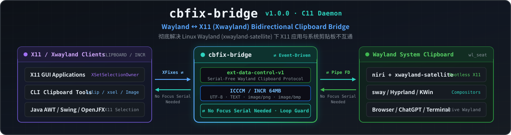

<div align="center">



# cbfix-bridge

**Seamless, Lossless Three-Way Clipboard Bridge: Wayland ⇄ X11 (XWayland) ⇄ Waydroid (Android)**

[](https://github.com/macOS-Terminal/linux-clipboard-fix/releases/latest)
[](https://github.com/macOS-Terminal/linux-clipboard-fix/releases/latest)
[](https://github.com/macOS-Terminal/linux-clipboard-fix/stargazers)
[](LICENSE)


**[简体中文](README.md) | [English](README_EN.md)**

</div>

> **Wayland ⇄ X11 (Xwayland) ⇄ Waydroid (Android) Three-Way Clipboard Bridge Daemon**
>
> On modern Wayland compositors (`niri` with `xwayland-satellite`, `sway`, `Hyprland`, etc.), X11 applications running under XWayland as well as **Waydroid (Android)** container apps frequently suffer from an isolated or broken clipboard: what you copy inside an X11 or Waydroid app won't paste into Wayland browsers, and what you copy in a browser won't paste into X11 or Waydroid apps. `cbfix-bridge` (`v1.1.4`) links the **Wayland system clipboard**, the **X11 `CLIPBOARD` selection**, and **Waydroid `IClipboard` Binder service** losslessly in a single, zero-framework C11 daemon built on `ext-data-control-v1`, ICCCM `INCR`, and dynamic `libgbinder`.
>
> **⭐ If `cbfix-bridge` saved your workflow, please consider clicking [Star](https://github.com/macOS-Terminal/linux-clipboard-fix/stargazers) in the top-right corner! It helps more Linux users and developers on `niri` / `xwayland-satellite` / `sway` / `Hyprland` / `Waydroid` discover this fix.**

Typical workloads cured by `cbfix-bridge`: **Waydroid Android apps**, **Java AWT / Swing / OpenJFX applications** running over X11, **CLI tools using `xclip` or `xsel`**, Wine programs, and any legacy or cross-platform X11 GUI software using the X11 `CLIPBOARD` selection.

- Single-file C11 daemon with zero runtime framework dependencies
- Three-way synchronization (**Wayland ⇄ X11 ⇄ Waydroid**) for UTF-8 text and images (`image/png` / `image/bmp`)
- Native Waydroid `IClipboard` Binder integration via runtime `dlopen("libgbinder.so.1")` — zero subprocess spawning, no `python-pyclip` needed, hot-plug container detection, and zero extra dependencies for users without Waydroid
- Full ICCCM `INCR` chunked transfer support — verified byte-for-byte up to 5 MB
- Turnkey `systemd --user` service (`enable --now` and forget)
- MIT License

---

## What the Symptoms Look Like

| Scenario | Observed Behavior |
|---|---|
| Copy text inside an X11 / Java GUI app → Paste in a Wayland browser | Pastes stale clipboard content or nothing at all |
| Copy text in a Wayland browser → Paste into an X11 GUI app | Input field remains empty |
| Copy output via `xclip` / `xsel` or an X11 CLI tool → Paste into a Wayland editor | Nothing is pasted |
| Copy text inside a Waydroid Android app → Paste in host Wayland / X11 apps | Nothing is pasted or stale content remains (common when `python-pyclip` is not installed) |
| Copy on host (especially right after copying an image/screenshot) → Paste inside Waydroid | Paste fails, errors out, or freezes inside Waydroid |
| Installing `xclip` or `xsel` does not help | They only read/write within the X11 server boundary and cannot cross into Wayland or Waydroid |

If unsetting `DISPLAY` makes a specific app's clipboard work, that app actually switched to a native Wayland backend—whereas true X11 clients (Java GUI apps, `xclip`-backed CLI tools, legacy X11 software) and Waydroid containers remain stranded without a bridge.

### Common Search Symptoms & Error Index (SEO Quick Reference)

If you landed here searching Google, Bing, GitHub Issues, or Reddit for any of these symptoms or error messages, `cbfix-bridge` is the exact fix:

- **`xwayland-satellite CLIPBOARD set from X11` logged, but `wl-paste` still returns old content**: `xwayland-satellite` attempts to call standard `wl_data_device.set_selection` without a keyboard focus serial, which the compositor silently drops—and the reverse Wayland → X11 direction is not implemented at all.
- **`XWayland apps cannot copy/paste to or from Wayland browsers on niri / sway / Hyprland`**: Java AWT/Swing/OpenJFX applications, Wine programs, and legacy X11 clients access `CLIPBOARD` via X11 (XWayland), which is isolated from the Wayland compositor's clipboard without a bridge.
- **`Waydroid clipboard not working on Wayland / Arch Linux` or `Waydroid paste fails / freezes after copying an image` (`clipboard_manager.py: canClip = False` / missing `python-pyclip`)**: Upstream `waydroid` relies on the optional third-party Python package `python-pyclip` to spawn `wl-copy` / `wl-paste` subprocesses on every copy/paste; when `python-pyclip` is missing (uninstalled by default on Arch, etc.), clipboard sharing silently disables itself (`canClip = False`), and when the host clipboard holds an image (`image/png`), an unparameterized `wl-paste` call fails or dumps raw binary bytes. `cbfix-bridge` talks directly to `lineageos.waydroid.IClipboard` over `/dev/binder` via `libgbinder` in memory with zero subprocesses.
- **`xclip / xsel or X11 CLI tool copy not pasting into Firefox or Chromium`**: CLI tools writing to the X11 `CLIPBOARD` selection cannot reach native Wayland apps without an `ext-data-control-v1` bridge.
- **`java.io.IOException: INCR data is missed` / `Owner failed to convert data` (Java AWT `XSelection` large paste failure)**: JDK's Xt/ICCCM `XSelection` implementation rejects zero-length `INCR` handshake markers and requires a 32-bit property containing the total byte count. `cbfix-bridge` implements the exact Xt/ICCCM `INCR` handshake expected by the JVM.
- **`wl-copy` prints `Nothing is copied` in background services or scripts (Wayland `wl_data_device.set_selection` focus serial restriction)**: Background processes lack a focused surface serial; `cbfix-bridge` uses the privileged `ext-data-control-v1` protocol instead.

---

## Root Cause

This is not an application bug—it is caused by the intersection of **Wayland's security model**, **missing functionality in XWayland clipboard bridging**, and **fragile subprocess clipboard handling in Waydroid**.

### 1. Wayland Requires a Focus Serial

Standard Wayland clients write to the clipboard via `wl_data_device.set_selection()`. The protocol requires the caller to pass a **recent keyboard focus `serial`** so background programs cannot silently hijack the clipboard.

A background clipboard bridge never owns a focused surface serial, so its `set_selection()` requests are **silently ignored** by the compositor—no error is raised, and nothing changes.

This is why `xwayland-satellite` fails silently. In its logs:

```
xwayland-satellite: new CLIPBOARD owner: Window { res_id: 20971527 }
xwayland-satellite: CLIPBOARD set from X11        ← It thinks it succeeded
```

Yet `wl-paste` still returns the previous Wayland clipboard content. And in the opposite direction (Wayland → X11), querying the X11 `CLIPBOARD` owner when Wayland holds data returns `0x0` (unowned)—**the Wayland → X11 direction is not implemented at all**.

### 2. The Remedy: `ext-data-control-v1`

Wayland provides the `ext-data-control-v1` protocol specifically for clipboard managers and X11 bridges: its `set_selection` request **does not require a focus serial**.

`cbfix-bridge` binds `ext-data-control-v1` on the Wayland side and directly manages `CLIPBOARD` ownership and ICCCM selection transfers on the X11 side.

### 3. Why Waydroid's Clipboard Breaks & How `cbfix-bridge` Solves It Natively

Although Waydroid windows render directly on the Wayland compositor, Android applications inside the container **do not use Wayland's `wl_data_device` for clipboard sharing**. Instead, they communicate with the host via the `waydroidclipboard` service on `/dev/binder` (or `/dev/anbox-binder`) using the `lineageos.waydroid.IClipboard` AIDL interface (`sendClipboardData` / `getClipboardData`).

The official `waydroid` Python script (`clipboard_manager.py`) suffers from two major pitfalls:
1. **Silent failure without `python-pyclip`**: It relies on the third-party Python library `python-pyclip` to spawn `wl-copy` / `wl-paste` subprocesses on every clipboard operation. On distributions like Arch Linux, `python-pyclip` is an optional dependency not installed by default—when absent, `canClip` silently evaluates to `False` and clipboard sync stops working completely.
2. **Errors or freezes when the clipboard holds images**: Even when `python-pyclip` is installed, if the system clipboard holds an image (`image/png`), calling `wl-paste` without explicit text MIME filtering either errors out or dumps raw binary data into the text channel, breaking or freezing paste inside Waydroid.

**How `cbfix-bridge` v1.1.4 solves this natively**:
- Dynamically loads `libgbinder` at runtime on demand via `dlopen("libgbinder.so.1")` (no hard build-time or install-time library dependency—users without Waydroid incur zero extra dependencies).
- Speaks the `lineageos.waydroid.IClipboard` Binder protocol directly in memory to synchronize **Waydroid ⇄ Wayland (`ext-data-control-v1`) ⇄ X11 (`CLIPBOARD`)** with zero subprocess overhead and full **hot-plug detection** when the Waydroid container starts or restarts.

### 4. Compositor Version Timeline

| Component | Minimum Version |
|---|---|
| niri | ≥ 25.05 |
| sway | ≥ 1.10 |
| Hyprland | ≥ 0.40 |
| KWin | ≥ 6.3 |
| Waydroid (Optional) | Any version providing `waydroidclipboard` (`libgbinder.so.1`) |
| GNOME / Mutter | Not applicable (ships its own built-in XWayland bridge; does not need this tool) |

Even when upstream `xwayland-satellite` eventually releases its `master`-branch X11 → Wayland patch, the **Wayland → X11** gap and **three-way Waydroid synchronization** remain unfilled without `cbfix-bridge`.

---

## Installation

### Option 0: Direct Release Package Download (10 Seconds, Recommended)

Download and install the prebuilt `v1.1.4` package for your distribution and enable the user service right away:

- **Arch Linux / Manjaro / EndeavourOS**:
  ```bash
  curl -fLO https://github.com/macOS-Terminal/linux-clipboard-fix/releases/download/v1.1.4/cbfix-bridge-1.1.4-1-x86_64.pkg.tar.zst
  sudo pacman -U cbfix-bridge-1.1.4-1-x86_64.pkg.tar.zst
  systemctl --user enable --now cbfix-bridge.service
  ```

- **Debian / Ubuntu / Linux Mint**:
  ```bash
  curl -fLO https://github.com/macOS-Terminal/linux-clipboard-fix/releases/download/v1.1.4/cbfix-bridge_1.1.4_amd64.deb
  sudo apt install ./cbfix-bridge_1.1.4_amd64.deb
  systemctl --user enable --now cbfix-bridge.service
  ```

- **Fedora / RHEL / openSUSE**:
  ```bash
  curl -fLO https://github.com/macOS-Terminal/linux-clipboard-fix/releases/download/v1.1.4/cbfix-bridge-1.1.4-1.x86_64.rpm
  sudo dnf install ./cbfix-bridge-1.1.4-1.x86_64.rpm
  systemctl --user enable --now cbfix-bridge.service
  ```

### Option 1: Build Native Packages Locally

```bash
git clone https://github.com/macOS-Terminal/linux-clipboard-fix
cd linux-clipboard-fix
./scripts/build-packages.sh arch     # Outputs dist/*.pkg.tar.zst (also supports rpm / deb / all)
sudo pacman -U dist/cbfix-bridge-1.1.4-1-x86_64.pkg.tar.zst
```

RPM: `sudo dnf install ./dist/cbfix-bridge-1.1.4-1.x86_64.rpm`; Deb: `sudo apt install ./dist/cbfix-bridge_1.1.4_amd64.deb`.

### Option 2: Install via Script

```bash
./scripts/install.sh
```

The script compiles the binary, installs it to `/usr/bin` (matching native package paths), and installs the systemd user unit into `~/.config/systemd/user/`.

### Option 3: Build from Source with `make`

```bash
git clone https://github.com/macOS-Terminal/linux-clipboard-fix
cd linux-clipboard-fix
make
```

Build dependencies:

| Distribution | Command |
|---|---|
| Arch | `sudo pacman -S base-devel wayland wayland-protocols libx11 libxfixes` |
| Debian/Ubuntu | `sudo apt install build-essential libwayland-dev wayland-protocols libx11-dev libxfixes-dev pkg-config` |
| Fedora | `sudo dnf install gcc make wayland-devel wayland-protocols-devel libX11-devel libXfixes-devel pkgconf` |

### Enable the systemd User Service (All Install Methods)

Run as your **current desktop user** (do **not** use `sudo`):

```bash
systemctl --user enable --now cbfix-bridge.service
systemctl --user status cbfix-bridge.service
journalctl --user -u cbfix-bridge -f      # Follow live logs
```

> **Note**: This is a systemd **user** service (`--user`), not a system-wide root service. It must run inside your graphical user session to access `DISPLAY` and `WAYLAND_DISPLAY`.

### Non-systemd Alternative

`niri` users can add the following line to `~/.config/niri/config.kdl`:

```kdl
spawn-at-startup "cbfix-bridge"
```

### Self-Test

```bash
cbfix-bridge --selftest
```

Four `[ OK ]` lines confirm that both display servers and selection protocols are working properly:

```
cbfix-bridge selftest
  DISPLAY         : :0
  WAYLAND_DISPLAY : wayland-1
  [ OK ] X11 connected (XFixes yes)
  [ OK ] Wayland connected, ext-data-control-v1 bound
  [ OK ] Wayland publish -> read back
  [ OK ] X11 second client reads our selection
selftest passed
```

### Uninstall

```bash
./scripts/uninstall.sh
```

---

## How It Works

```
┌──────────────────────┐   ext-data-control-v1    ┌──────────────────┐   libgbinder (dlopen)  ┌──────────────────────┐
│  Wayland Clipboard   │ ◄──────────────────────► │   cbfix-bridge   │ ◄────────────────────► │  Waydroid (Android)  │
│ (Held by Compositor) │   Serial-free Read/Write │(Background Daemon│  IClipboard (/dev/binder)│  waydroidclipboard   │
└──────────────────────┘                          └────────┬─────────┘                        └──────────────────────┘
                                                           │ Owns X11 CLIPBOARD
                                                           │ Full TARGETS / INCR
                                                   ┌───────┴────────┐
                                                   │ Java / xclip / │
                                                   │ All X11 Clients│
                                                   └────────────────┘
```

| Direction | Trigger | Implementation |
|---|---|---|
| X11 → Wayland & Waydroid | XFixes `SetSelectionOwnerNotify` | Reads X11 `CLIPBOARD` (prefers `image/png`, falls back to `UTF8_STRING`/`TEXT`), publishes via `ext_data_control_device_v1.set_selection()`, and forwards UTF-8 text to Waydroid via `IClipboard::sendClipboardData` |
| Wayland → X11 & Waydroid | `ext_data_control_device_v1.selection` event | Reads compositor offer, claims X11 `CLIPBOARD` ownership, serves `TARGETS`/`UTF8_STRING`/`TIMESTAMP` per ICCCM (streaming large payloads over `INCR`), and forwards UTF-8 text to Waydroid |
| Waydroid → Wayland & X11 | `IClipboard` Binder update / poll | Reads updated Android clipboard text via `dlopen("libgbinder.so.1")` and simultaneously publishes to Wayland `ext-data-control-v1` and X11 `CLIPBOARD` |

### 7 Key Engineering Design Details

1. **FNV-1a Echo Suppression**: Tags every payload pushed across the bridge with a 64-bit FNV-1a content hash. When the mirrored offer reappears on another endpoint, `cbfix-bridge` recognizes its own hash and suppresses re-forwarding, preventing infinite three-way ping-pong loops.
2. **Sticky Ownership**: Automatically reclaims X11 `CLIPBOARD` ownership whenever the X11 selection becomes unowned (`0x0`), ensuring clipboard data stays persistently available even after the source app closes.
3. **Pinned INCR Snapshots**: Each in-flight `INCR` transfer (up to 8 concurrent slow readers) holds its own immutable heap snapshot of the payload. Mid-transfer clipboard changes on Wayland never truncate or corrupt an ongoing X11 read.
4. **32-Bit Total-Length Marker for JDK `XSelection`**: Strictly follows the ICCCM/Xt convention by writing a 32-bit property containing the total payload byte length during the `INCR` handshake. Clients built on Xt/AWT (including OpenJDK's `XSelection`) reject zero-length markers with `java.io.IOException: INCR data is missed`.
5. **Event Starvation Prevention (`XPending` Drain Before `poll()`)**: Synchronous Xlib round-trips (`XGetWindowProperty`, etc.) silently buffer incoming X events into Xlib's internal queue, causing a naive fd `poll()` loop to sleep forever mid-`INCR`. The main loop **drains before polling**, treating `XPending()` rather than `poll()` as the authoritative signal for pending X11 work.
6. **Dropped `PropertyDelete` & `BadWindow` Self-Healing**: If a reading client crashes or closes its window mid-transfer (`BadWindow`), the `INCR` slot is cleanly reclaimed. If a `PropertyDelete` notification is lost under heavy traffic, `cbfix-bridge` probes the target property's actual state on the requestor window—distinguishing a slow reader from a dropped notification and resuming chunk delivery seamlessly.
7. **On-Demand `libgbinder` Dynamic Loading & Hot-Plug Waydroid Sync**: Uses `dlopen("libgbinder.so.1")` at runtime to talk directly to `lineageos.waydroid.IClipboard` with zero subprocesses and no `python-pyclip` dependency. Systems without Waydroid incur zero extra runtime dependencies, and Waydroid containers started or restarted at any time are automatically detected and synchronized.

---

## Testing & Verified Benchmarks

```bash
make && ./build/cbfix-bridge --selftest   # Environment self-test
bash tests/run-tests.sh                   # 9 functional regression tests
bash tests/run-bulk-tests.sh              # Large payloads / concurrency / crash recovery
```

### Benchmark Results

Test environment: Arch Linux, `niri` 26.04 + `xwayland-satellite` 0.8.3, `Xwayland` 24.1.

| Test Suite | Result |
|---|---|
| `--selftest` | **4/4** |
| Functional regression: Java/AWT bidirectional, Unicode/CJK/emoji, multiline, empty payload, 20× rapid alternation, echo loop suppression, liveness | **9/9** |
| Large `INCR` payloads: 100 KB / 300 KB / 1 MB / 5 MB × 3 rounds, byte-for-byte comparison | **12/12** |
| 4 concurrent readers fetching 5 MB simultaneously | **4/4 byte-identical** |
| Service recovery after reader is killed with `kill -9` mid-transfer | **Passed** |
| 30× rapid copy storm (with `fcitx5` active) | **Consistent final state on both sides, 0 warnings** |

The Java reference client (using the JVM's built-in ICCCM `INCR` implementation—the actual code path executed by Java AWT/Swing/OpenJFX apps) reads the full byte length across 300 KB, 1 MB, and 5 MB transfers without error.

---

## Command-Line Interface

```
cbfix-bridge [OPTIONS]

  --interval MS          Fallback polling interval for X11 owner checks (default 120, min 20)
  --no-waydroid          Disable Waydroid (IClipboard) Binder bridge
  --waydroid-device DEV  Override Waydroid Binder device path (default auto-detects /dev/binder, /dev/anbox-binder)
  --verbose, -v          Enable verbose debug logging
  --selftest             Verify X11 + Wayland environment and exit
  --status               Print current clipboard and Waydroid connection state and exit
  --version, -V          Print version (1.1.4) and exit
  --help, -h             Show help message
```

Exit codes: `0` success / `1` environment unavailable or selftest failed / `2` invalid command-line arguments.

---

## Troubleshooting

| Symptom | Cause | Resolution |
|---|---|---|
| Service restarts in a loop with `usage: ...` and `status=2/INVALIDARGUMENT` | A placeholder/fixture binary is installed (`cbfix-bridge --help` lacks `--interval` or mentions `fixture`) | Rebuild and install from this repository, then run `systemctl --user restart cbfix-bridge.service` |
| Exits immediately: `compositor does not offer ext-data-control-v1` | Compositor is too old or unsupported | Upgrade your compositor according to the Version Timeline table above |
| Exits immediately: `cannot connect to the Wayland compositor` | `WAYLAND_DISPLAY` is missing from the systemd user environment | Run `systemctl --user import-environment WAYLAND_DISPLAY DISPLAY` and restart the service |
| Exits immediately: `cannot open the X display` | XWayland is not running or `$DISPLAY` is unset | Ensure XWayland/`xwayland-satellite` is running and `echo $DISPLAY` is non-empty |
| `--selftest` fails on the X11 check | X connection works, but selection ownership is contested | Check if another clipboard manager is aggressively locking `CLIPBOARD` |
| Waydroid clipboard not syncing | `libgbinder` is not installed or Waydroid uses a custom Binder device | Ensure `libgbinder` is installed (check `cbfix-bridge --status`) or pass `--waydroid-device` |
| Pasting yields stale content in a specific app | Target application caches `Transferable` internally (seen in some Java versions) | Restart the application; check bridge logs (`-v`) to verify the new payload was delivered |
| Large transfer stalls | If reproducible, open an issue with `-v` logs attached | Inspect via `journalctl --user -u cbfix-bridge -b \| grep -iE "stalled\|lost"` |

Use `cbfix-bridge --status` to inspect all endpoints at a glance:

```
X11 CLIPBOARD owner : 0x400001
Wayland mime types  : text/plain;charset=utf-8, text/plain, UTF8_STRING, TEXT, STRING
Wayland content     : 42 bytes (text)
Waydroid IClipboard : connected (/dev/binder)
```

---

## Known Scope & Boundaries

- Synchronizes UTF-8 text and `image/png` / `image/bmp` (note: Waydroid's `IClipboard` AIDL interface only supports UTF-8 text, so text is synced with Waydroid while image payloads are safely skipped on the Waydroid leg without errors or freezes). Application-private MIME types (such as internal LibreOffice formats) gracefully fall back to plain text.
- Bridges `CLIPBOARD` only—**does not bridge `PRIMARY`** (middle-click selection).
- Requires the Wayland compositor to advertise `ext-data-control-v1`; GNOME/Mutter is neither supported nor needed.
- Must run inside an active desktop session; has no effect in pure TTY or headless environments.
- Bridges **Wayland ⇄ X11 (XWayland) ⇄ Waydroid (Android)**. Native Wayland apps already share the clipboard directly through the compositor. Electron/Chromium apps running under `ozone=auto` are typically native Wayland clients, so they need `cbfix-bridge` whenever they exchange clipboard data with X11 apps (such as Java GUI programs or `xclip`/`xsel` tools) or Waydroid Android apps.

---

## Project Structure

```
src/cbfix-bridge.c                    Bridge daemon implementation (C11)
protocols/ext-data-control-v1.xml     Vendored Wayland protocol XML
systemd/cbfix-bridge.service          systemd user service unit
scripts/install.sh                    Build + install to /usr/bin + install user unit (--uninstall reverses)
scripts/uninstall.sh                  Uninstall helper
scripts/build-packages.sh             Package builder: arch | rpm | deb | all → dist/
scripts/build-rpm.sh / build-deb.sh   RPM / Debian package build scripts
packaging/notice.sh                   Post-install highlighted user notice (single source of truth)
packaging/PKGBUILD, cbfix-bridge.install, cbfix-bridge.spec, debian/
tests/run-tests.sh                    Functional regression suite (9 tests)
tests/run-bulk-tests.sh               Large payload / concurrency / crash recovery suite
tests/x11-read.c                      Test helper: ICCCM-compliant X11 selection reader
Makefile                              make / make check / make install / make test
```

Common `make` targets:

```bash
make            # Build binary
make deps       # Check build dependencies
make check      # Run environment self-test
make install    # Install binary and systemd unit (supports DESTDIR / PREFIX)
make test       # Run all test suites
```

---

## Acknowledgements & References

- [`ext-data-control-v1`](https://gitlab.freedesktop.org/wayland/wayland-protocols/-/tree/main/staging/ext-data-control) — `wayland-protocols`
- [xwayland-satellite](https://github.com/Supreeeme/xwayland-satellite) — Rootless XWayland integration for `niri`
- ICCCM 2.0 specification for `TARGETS` and `INCR` selection transfers

---

## Support & Star History

If `cbfix-bridge` fixed your clipboard in everyday X11 / XWayland applications, please give this repository a **⭐ [Star](https://github.com/macOS-Terminal/linux-clipboard-fix/stargazers)** and share it with fellow `niri`, `sway`, and `Hyprland` users! Every Star helps more people find a working solution instead of struggling with broken XWayland copy-paste.

[](https://star-history.com/#macOS-Terminal/linux-clipboard-fix&Date)

---

## License

[MIT](LICENSE)
